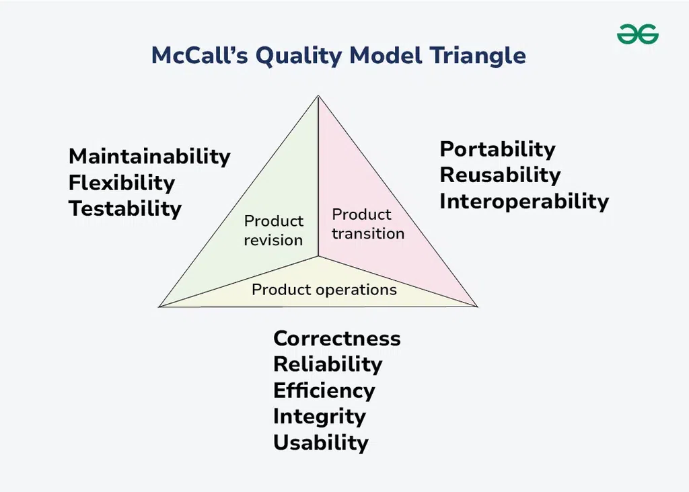
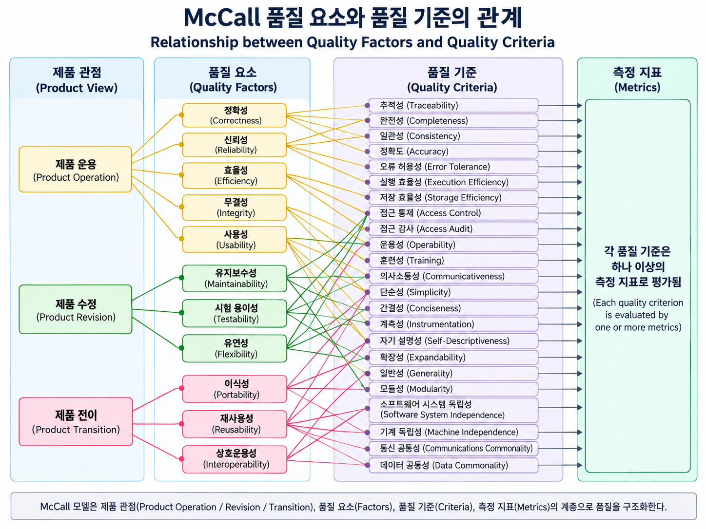
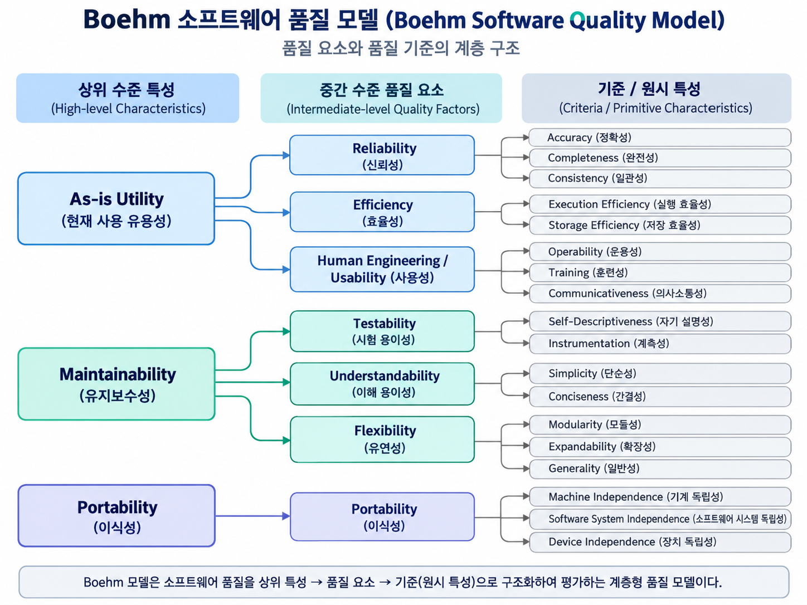

<!-- markdownlint-disable MD007 MD010 MD025 -->

# 소프트웨어 품질 모델: McCall, Boehm, FURPS, Dromey

1. [McCall (1977)](#1-mccall-1977)
	1. [품질 요소](#12-품질-요소)
	2. [품질 기준](#13-품질-기준)
	3. [장점과 한계](#14-장점과-한계)
2. [Boehm (1978)](#2-boehm-1978)
	1. [구조(3계층)](#22-구조3계층)
	2. [모델 관계·특징](#23-모델-관계특징)
	3. [장점·한계](#24-장점한계)
3. [FURPS(+)](#3-furps)
	1. [목적·배경](#31-목적배경)
	2. [구조](#32-구조)
	3. [모델 관계/특징](#33-모델-관계특징)
	4. [장점·한계](#34-장점한계)
4. [Dromey](#4-dromey)
	1. [목적·배경](#41-목적배경)
	2. [구조](#42-구조)
	3. [모델 관계/특징](#43-모델-관계특징)
	4. [장점·한계](#44-장점한계)
5. [출처](#출처)

---

## 1. McCall (1977)

- 1977년 짐 매콜(Jim McCall) 등이 미 공군의 의뢰로 만든 소프트웨어 품질 모델이다.
- 사용자가 느끼는 품질 요소(factor)**와 개발자가 제품 안에서 확인하는 품질 기준(criteria)을 연결해 품질을 측정하게 한 모델이다.
- 11개 품질 요소(factor) → 23개 품질 기준(criteria) → 측정(metric)의 계층형 모델이다.
	- **품질 요소(factor)**: 사용자, 관리자가 바깥에서 보는 품질. 사용자 관점의 외부 품질이다.
	- **품질 기준(criteria)**: 요소를 이루는 제품 내부의 속성. 개발자 관점의 내부 품질이다.
	- **측정(metric)**: 기준을 재는 측정값과 점검표이다.
- 메트릭은 예/아니오 질문으로 각 기준을 정량화하고, 기준→요인→제품 수준으로 합성이 가능하다. 단, 응답자 주관성이 한계로 지적된다.

> 그림 출처: *[Geeksforgeeks: McCall's Quality Model](https://www.geeksforgeeks.org/software-engineering/mccalls-quality-model/)*

### 1.2. 품질 요소

품질 요소를 다음 3가지 관점으로 분류한다.

- 제품 운영/운용 특성(Product Operations)
- 제품 수정/변경 용이성(Product Revision)
- 제품 전이, 환경 전이 적응(Product Transition)

#### 1.2.1. 제품 운영/운용 특성(Product Operations)

소프트웨어 작동에 직접적인 영향을 미치는 요구 사항이 포함된다.

- 정확성(Correctness): 요구사항을 충족하는 정도
- 신뢰성(Reliability): 일정 기간 동안 오류 없이 수행되는 정도
- 효율성(Efficiency): 자원 사용 대비 성능 수준
- 무결성(Integrity): 불법 접근이나 오류로부터 보호되는 정도
- 사용성(Usability): 사용자가 시스템을 쉽게 배우고 사용할 수 있는 정도

#### 1.2.2. 제품 수정/변경 용이성(Product Revision)

소프트웨어 테스트 및 유지 관리에 필요한 요구 사항이 포함된다.

- 유지보수성(Maintainability): 오류 수정 및 기능 개선 용이성
- 유연성(Flexibility): 변경 요구에 대응하는 용이성
- 시험성(Testability): 테스트 수행 용이성

#### 1.2.3. 제품 전이, 환경 전이 적응(Product Transition)

소프트웨어가 이전 환경에서 새로운 플랫폼이나 기술 환경으로 변화하는 환경에 적응할 수 있도록 하는 품질 요소가 포함된다.

- 이식성(Portability): 다른 환경으로 이전할 수 있는 정도
- 재사용성(Reusability): 다른 시스템 구성 요소로 재활용 가능한 정도
- 상호운용성(Interoperability): 다른 시스템과 상호작용 가능한 정도

### 1.3. 품질 기준

> 그림 출처: McCall, J. A., Richards, P. K., & Walters, G. F. (1977). Factors in Software Quality. Rome Air Development Center, RADC-TR-77-369. [원본 도식](https://www.researchgate.net/publication/228728142_Collaborative_Systems_Defining_and_Measuring_Quality_Characteristics)을 참고하여 AI로 재구성.

| 품질 요소  | 주요 품질 기준                                                                  |
| ------ | ------------------------------------------------------------------------- |
| 정확성    | 추적성(Traceability), 완전성(Completeness), 일관성(Consistency)                    |
| 신뢰성    | 일관성, 정밀성(Accuracy), 오류 허용성(Error Tolerance), 단순성(Simplicity)              |
| 효율성    | 실행 효율성(Execution Efficiency), 저장 효율성(Storage Efficiency)                  |
| 무결성    | 접근 통제(Access Control), 접근 감사(Access Audit)                                |
| 사용성    | 운용성(Operability), 훈련성(Training), 의사소통성(Communicativeness)                 |
| 유지보수성  | 일관성, 단순성, 간결성(Conciseness), 자기 설명성(Self-descriptiveness), 모듈성(Modularity) |
| 유연성    | 자기 설명성, 확장성(Expandability), 일반성(Generality), 모듈성                          |
| 시험 용이성 | 단순성, 모듈성, 계측성(Instrumentation), 자기 설명성                                    |
| 이식성    | 자기 설명성, 모듈성, 소프트웨어 시스템 독립성, 기계 독립성                                        |
| 재사용성   | 일반성, 모듈성, 소프트웨어 시스템 독립성, 기계 독립성, 자기 설명성                                   |
| 상호 운용성 | 모듈성, 통신 공통성(Communications Commonality), 데이터 공통성(Data Commonality)        |

### 1.4. 장점과 한계

장점

- 제품 품질을 **구체 항목(요인/기준)**으로 쪼개 **사전 점검 체크리스트**를 만들기 쉽다.
- 소프트웨어 품질을 다차원적인 관점에서 정의한다.
- 개발, 운영, 유지보수 전 과정에 걸친 품질 관리 기준을 제시한다.

한계

- 일부 기준/질문이 **주관적**이고, 최신 표준(예: ISO 9126/25010)의 세부 분류 대비 **표현력이 제한**될 수 있다.

## 2. Boehm (1978)

- 1978년 Barry W. Boehm이 제안한 소프트웨어 품질 모델이다.
- 자동·정량 평가의 한계를 보완하기 위해 **속성 집합과 메트릭으로 품질을 정성적으로 정의**하는 **계층형 모델**(상위→중간→원시 특성)이다.
- McCall 모델이 주로 상위 수준 특성의 정밀한 측정에 초점을 맞추는 반면, Boehm 모델은 더 광범위한 특성을 기반으로 한다.

> **그림 출처:** Bitew, N., & Singh, J. (2019). _A Study on Software Quality Factors and Metrics to Enhance Software Quality Assurance_, Figure 4, “Boehm software quality model.” [원본 도식](https://www.researchgate.net/figure/Boehm-software-quality-model_fig3_337550373)을 참고하여 AI로 재구성.

### 2.2. 구조(3계층)

1. **상위 특성(High-level)**: 사용자가 실제로 묻는 3가지 질문
	- **유용성(As-is Utility)**: 지금 당장 신뢰성·효율성·사용성 측면에서 잘 쓸 수 있는가?
	- **유지보수성(Maintainability)**: 이해·수정·재테스트가 쉬운가?
	- **이식성(Portability)**: 환경이 바뀌어도 쓸 수 있는가?
2. **중간 요인(7 Factors)**: 시스템에 기대되는 품질, 각 요인의 정의와 귀속(As-is, Maintainability, General Utility)까지 제시
	- **이식성(Portability)**
	- **신뢰성(Reliability)**
	- **효율성(Efficiency)**
	- **사용성(인간공학)(Usability)**
	- **테스트 용이성(Testability)**
	- **이해 용이성(Understandability)**
	- **수정 용이성(Flexibility(=Modifiability))**.
3. **원시 특성(Primitive) & 메트릭 계층**: **측정 기반**을 제공(특성별 하나 이상 메트릭 연결).

### 2.3. 모델 관계·특징

- McCall과 유사한 계층형이지만, **유지보수성(maintainability) 강조**가 더 강하고 특성 범위가 **넓다**는 점이 차별점.
- 상위 3특성(As-is, Maintainability, Portability)은 **General Utility**의 필요조건(충분조건은 아님).
- 품질 역량 향상이 가져올 **유지보수 비용 효율(maintenance cost-effectiveness)** 을 주요 보상으로 본다.

### 2.4. 장점·한계

- **장점**:
	- 사용자 관점 질문→중간 요인→측정 가능한 원시 특성으로 **추적 가능**;
	- 유지보수성 중심의 **실무 친화적** 프레임.
- **한계**: 현대 표준(ISO/IEC 25010)에 비해 **보안·호환성 등 최신 축**은 상대적으로 약함(역사적 모델).

## 3. FURPS(+)

### 3.1. 목적/배경

- **요구사항을 구조화**하기 위한 모델: 기능(**F**)과 비기능(**URPS**)을 체계로 나눠 **요구 수집·평가**에 모두 쓰도록 설계됨.
- **기원/확장**: Robert Grady가 제안, 이후 Rational이 **FURPS+** 로 확장.
- **맥락**: McCall/Boehm과 **유사한 구조의 후속 모델**(덜 유명하지만 언급 가치).

### 3.2. 구조

- **5범주**
    - **F**unctionality: 기능 집합·능력·보안.
    - **U**sability: 인간공학·미학·UI 일관성·도움말/문서/교육.
    - **R**eliability: 고장 빈도·복구 가능성·예측 가능성·정확성·**MTBF**.
    - **P**erformance: 속도·효율·가용성·처리량·응답/복구 시간·자원 사용.
    - **S**upportability: 테스트성·확장성·적응성·유지보수성·호환성·설치·현지화.
- **F vs URPS**: F=기능 요구, URPS=비기능 요구(요구 정의/품질 평가에 **모두 사용 가능**).
- **“+”의 의미**: **설계 제약**, **구현 요구**, **인터페이스 요구**, **물리적 요구** 등 부가 항목 포함.

### 3.3. 모델 관계/특징

- **관계**: McCall·Boehm과 **같은 계층적 분류 틀**을 취하면서, 요구/평가에 **직접 적용** 가능한 카테고리 제공.
- **특징**: 기능(**F**)과 비기능(**URPS**)을 명시적으로 분리해 **NFR 누락 방지**와 **공통 언어**를 제공.

### 3.4. 장점/한계

- **장점**
    - **요구 수집용 프레임**: 초기에 빠르게 범주화하고, 릴리스 전/후 평가 항목으로 **재사용** 가능.
    - **포괄성**: 보안·가용성·설치·현지화 등 **실무적 비기능**을 폭넓게 커버.
- **한계**
    - **표준 메트릭 규정 부재**: 모델이 지표/치 환값을 **규격화해 주진 않으므로**, 팀이 프로젝트 맥락에 맞게 **정량 기준(AC)** 을 별도 정의해야 함(모델은 분류 틀 중심).
    - **역사적 분류 모델**: 최신 표준(예: ISO/IEC 25010)처럼 공식 **규격·평가지표 세트**를 제공하는 형태는 아님(요구 분류·평가의 보조 틀에 강점).

## 4. Dromey

### 4.1. 목적/배경

- 제품마다 “품질 평가가 다르다”는 현실을 반영하여, **제품 속성(Product properties)** 을 **품질 속성(Quality attributes)** 에 **동적으로 연결**해 평가하는 **제품기반 모델**을 제안. McCall·Boehm·FURPS(+)와 유사한 계보에서 발전.

### 4.2. 구조

- **핵심 3요소**:
	- 품질에 영향 주는 **제품 속성**
	- **고수준 품질 속성**
	- 두 집합을 잇는 **링킹 메커니즘**
- **5단계 절차**:
    1. 평가에 필요한 **고수준 품질 속성 선택**
    2. **컴포넌트/모듈 목록화**
    3. 각 컴포넌트의 **품질-보유 속성 식별**
    4. 속성이 **품질 속성에 미치는 영향 규정**
    5. **모델 평가 및 약점 식별**.

### 4.3. 모델 관계/특징

- **관계**: McCall·Boehm·FURPS(+)와 같은 **계층/속성 기반 품질 모델** 계열에 속하며, 차별점은 **제품 속성↔품질 속성의 명시적 연결**과 **평가의 동적 적용성**.
- **출전**: Dromey 1995(IEEE TSE), 1996(IEEE Software)로 정리됨.

#### 4.4. 장점/한계

- **장점**
    - **맞춤형 평가**: 시스템/컴포넌트 수준에서 **실제 제품 속성**을 품질 속성과 직접 매핑 → 프로젝트별 **타당한 품질 체크리스트**를 구성 가능.
    - **추적성**: “어떤 구현 속성이 어떤 품질에 영향을 주는가”를 **근거 기반**으로 설명 가능(링킹 메커니즘).
- **한계**
    - **모델 일반 한계 공유**: 품질을 정량화 가능한 정적 속성 집합으로 축약하는 경향이 있어, **동적으로 변하는 고객 기대**를 모두 포착하기 어렵다.
    - **실행 부담**: 컴포넌트 수준 **속성 식별·매핑** 작업이 요구되어 초기 셋업 비용이 듦(5단계 절차 특성상).

---

## 출처

- ACADEMIA. 「Software Quality Models and Philosophies」. [Academia.edu](https://www.academia.edu/24491465/Chapter_One_1_Software_Quality_Models_and_Philosophies_1_1_Introduction)
- IT 위키. 「McCall 품질 모델」. [IT 위키](https://itwiki.kr/w/McCall_%ED%92%88%EC%A7%88_%EB%AA%A8%EB%8D%B8)
- GeeksforGeeks. 「McCall's Quality Model」. [GeeksforGeeks](https://www.geeksforgeeks.org/software-engineering/mccalls-quality-model/)
- Doinea, M., & Van Osch, W. (2010). 「Collaborative Systems: Defining and Measuring Quality Characteristics」. _Journal of Applied Collaborative Systems_, 2(1), 50–61. [ResearchGate](https://www.researchgate.net/publication/228728142_Collaborative_Systems_Defining_and_Measuring_Quality_Characteristics)
- Tistory. 「(소프트웨어공학) McCall의 품질 모델」. [Tistory](https://continuetochallenge.tistory.com/186)
- GeeksforGeeks. 「Boehm's Software Quality Model」. [GeeksforGeeks](https://www.geeksforgeeks.org/software-engineering/boehms-software-quality-model/)
- Bitew, N., & Singh, J. (2019). 「A Study on Software Quality Factors and Metrics to Enhance Software Quality Assurance」. Figure 4, _Boehm Software Quality Model_. [ResearchGate](https://www.researchgate.net/figure/Boehm-software-quality-model_fig3_337550373)
